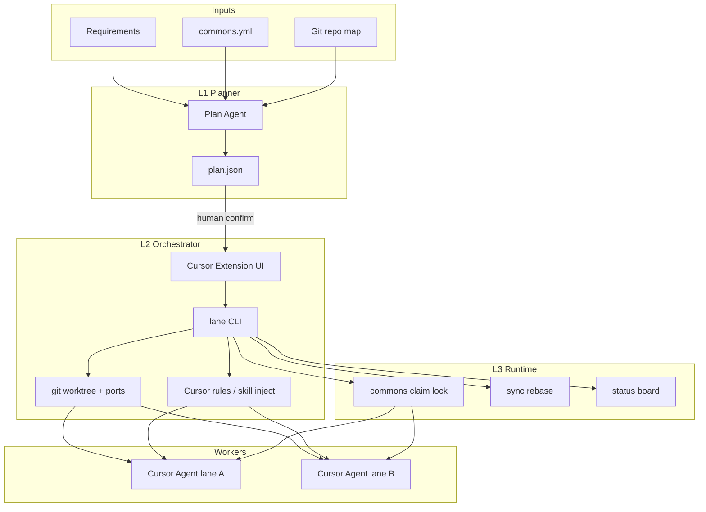

# 多需求并行编排器（Planner + Workers）产品计划

> 仓库：`D:\personal\lane`  
> 进度：M0 契约 + **L1（init/plan/confirm）已落地**；L2/L3/扩展待做。  
> 人工走读：[walkthrough.md](./walkthrough.md)

## 里程碑状态

| ID | 内容 | 状态 |
|----|------|------|
| m0-schema | commons/plan/state 契约与架构文档 | done |
| m2-planner / L1 CLI | `lane init/plan/confirm`（规则 + 可选 LLM） | done |
| m1-cli-core | `start/status/sync/done/doctor` | todo |
| m3-extension | Cursor/VS Code 扩展 | todo |
| m4-runtime-lock | commons claim 锁 | todo |
| m5-oss-release | 开源发布与商业化边界 | todo |

## 产品定位

**一句话**：把「多需求 / 多 worktree / 多 AI 会话」从口头约定，变成「规划 → 确认 → 启动 → 同步 → 收尾」的可重复流水线。

**不是**：替人写业务代码的超级 Agent。  
**是**：窄编排 Agent + 确定性执行器；Cursor 里的编码 Agent 仍是 Worker。

**默认决策（已拍板）**：
- 独立仓库（不塞进现有 SaaS）
- **CLI 为唯一真相源**；Cursor/VS Code 扩展只调用 CLI
- 开源核心（Apache-2.0）；商业化走「团队协作 / 云端锁板 / 策略市场」增值，不锁死本地 CLI
- 第一阶段只深耕 **Git worktree + Cursor 规则注入**；不强依赖 Cursor 官方「一键派 N 个 Agent」API（该能力不稳时用「开 N 个窗口/目录 + 自动生成会话开场」半自动）

**建议产品名（可改）**：`lane`（泳道）或 `wtctl`；下文用 `lane`。

---

## 总体架构



**分层职责**：

| 层 | 智能程度 | 可靠性来源 | 产出 |
|----|----------|------------|------|
| L1 Planner | 高（LLM） | 人确认计划 | `plan.json` |
| L2 Orchestrator | 低（脚本） | Git / 文件系统 | worktree、端口、规则文件 |
| L3 Runtime | 中（规则+状态机） | 文件锁 / 状态库 | claim、sync、done 门禁 |

---

## 核心数据模型（先定契约，再写代码）

### 1. `commons.yml`（仓库侧，人工维护起步）

放在目标仓库根目录，例如 `.lane/commons.yml`：

```yaml
version: 1
paths:
  - src/components/**
  - src/utils/**
  - src/routes/**/index.ts   # 例：路由聚合
  - packages/*/package.json
  - pnpm-lock.yaml
  - **/i18n/**
policy:
  max_parallel_touching_commons: 1
  require_claim_before_edit: true
```

### 2. `plan.json`（L1 产出，人确认后冻结）

```json
{
  "version": 1,
  "baseBranch": "release/3.15",
  "lanes": [
    {
      "id": "live-schedule",
      "title": "直播排期",
      "branch": "feat/live-schedule",
      "worktreePath": "../feat-live-schedule",
      "port": 5174,
      "touchesCommons": false,
      "allowedPaths": ["src/routes/LiveControl/**"],
      "forbiddenPaths": ["$commons"],
      "dependsOn": [],
      "acceptance": ["排期 CRUD 可用", "端口 5174 可起"]
    },
    {
      "id": "commons-routes",
      "title": "公共：注册排期路由",
      "touchesCommons": true,
      "dependsOn": [],
      "order": "before:live-schedule"
    }
  ],
  "serialGroups": [["commons-routes"], ["live-schedule", "other-feature"]],
  "risks": ["两个业务都想加路由 → 已抽 commons-routes"]
}
```

### 3. `.lane/state.json`（L2/L3 运行时）

记录：lane 状态（planned/active/blocked/done）、端口占用、claim 持有者、相对 base 是否落后、worktree 路径。

契约原则：**扩展只读写这些文件 + 调 CLI；禁止扩展里再实现一套 Git 逻辑。**

---

## L1 — 规划 Agent（先做，可独立卖「规划」）

### 目标

输入多条需求（Markdown / 飞书链接文本 / 粘贴），输出可执行的并行计划，并标出公共层冲突。

### 能力范围（MVP）

1. 解析需求列表 → 候选 lane
2. 结合 `commons.yml` + 可选「历史改动热区」（`git log --name-only` 粗统计）→ 标记 `touchesCommons`
3. 有冲突则自动拆出 `commons-*` 前置 lane，或标为 serial
4. 生成 `plan.json` + 给人看的摘要（中文）
5. **必须人工 Confirm** 才进入 L2（CLI flag `--confirm` 或扩展按钮）

### 实现要点

- 包：`@lane/planner`（纯函数 + LLM adapter）
- Provider：先支持 OpenAI 兼容 API / Cursor 侧「把 prompt 丢给当前模型」两种模式
- 无 LLM 也能跑：**规则模式**（只按路径关键词启发式拆分）——方便 CI 测、也方便开源用户零成本试用
- Prompt 里强制输出 JSON Schema，校验失败则重试一次

### 验收

- 给定 3 条样例需求（2 业务 + 都碰路由），稳定产出「1 公共前置 + 2 并行业务」或「全串行」且理由可读
- 无 `commons.yml` 时降级警告，不瞎并行

---

## L2 — 编排执行器（CLI + 薄扩展）

### CLI 命令（内核）

```text
lane init                 # 写入 .lane/commons.yml 模板 + gitignore 建议
lane plan [--from file]   # 调 L1，写出 plan.json（未确认）
lane confirm              # 冻结计划
lane start <lane-id|all>  # worktree add、分配端口、写规则、打印「请用 Cursor 打开该目录」
lane status               # 泳道看板
lane sync [lane-id]       # fetch + rebase/merge baseBranch
lane done <lane-id>       # 检查干净 → 提示 PR → remove worktree（需 --yes）
lane doctor               # git 版本、端口冲突、孤儿 worktree
```

### `lane start` 必须自动做的事

1. `git worktree add <path> -b <branch> <base>`
2. 分配端口写入 `.env.local`（或打印手动项，按项目模板）
3. 生成该 lane 的 Cursor 规则，例如 `.cursor/rules/lane-<id>.mdc`：
   - 只允许 `allowedPaths`
   - 禁止 `$commons`（除非该 lane `touchesCommons: true` 且持有 claim）
4. 生成 `SESSION_BOOTSTRAP.md`（会话开场粘贴文案），减少「每次口头叮嘱」
5. 更新 `state.json`

### Cursor / VS Code 扩展（壳）

- 视图：计划摘要、泳道状态、一键 Confirm / Start / Sync / Done
- 设置：CLI 路径、默认 base branch、包管理器
- **不内嵌 Git**；所有动作 `child_process` 调 `lane`
- 开源版功能与 CLI 对齐即可；商业版再加团队看板同步

### 验收

- 在样例 monorepo/普通前端仓：`plan → confirm → start` 后出现独立目录 + 规则文件 + 端口
- `done` 后 worktree 删除，`git worktree list` 干净
- 故意不 Confirm 就 `start` → 失败且提示清晰

---

## L3 — 运行时协调（第二阶段）

### 目标

执行期防止多 lane 同时改公共层，并让后开 lane 始终基于最新 base。

### MVP 机制（文件锁，简单可靠）

- `.lane/locks/commons.lock`：JSON `{ holder, laneId, expiresAt }`
- `lane claim commons` / `lane release commons`
- `start` 时若 `touchesCommons` 且锁被占 → 拒绝启动或标 blocked
- Worker 规则写明：检测到要改 commons 路径 → 停止并提示 `lane claim` 或升格公共卡
- `lane sync`：合并 base；冲突时停住并写进 `status`
- 可选：`lane watch` 轮询落后 commits，状态栏提示

### 暂不做（避免一口吃成胖）

- 自动解 merge 冲突
- 自动创建 GitHub/GitLab MR 并合并
- 跨机器分布式锁（商业版再做：Redis/云端 board）
- 真正「进程内调度多个 Cursor Agent」

### 验收

- 两 lane 同时 `claim commons` → 第二人失败
- 公共 lane `done` 后，业务 lane `sync` 能吃到路由变更
- 过期锁可 `lane doctor --fix-locks`

---

## 仓库与包结构（独立 monorepo）

```text
lane/
  packages/cli          # lane 可执行文件
  packages/core         # plan/state/lock/git wrappers
  packages/planner      # L1
  packages/ext-cursor   # VS Code/Cursor extension
  templates/            # commons.yml、rule、bootstrap
  examples/demo-repo    # 验收用假仓库
  docs/                 # 用户文档 + 架构
```

技术选型默认：
- TypeScript + Node 20+
- Git 调用：`simple-git` 或封装 `git` 子进程（优先子进程，行为与人手一致）
- 扩展：VS Code Extension API（Cursor 兼容）
- 测试：核心纯函数单测 + `examples/demo-repo` 集成测（临时目录真跑 worktree）

---

## 里程碑与工时（单人业余粗估）

| 里程碑 | 内容 | 约工时 |
|--------|------|--------|
| M0 | 契约：`commons.yml` / `plan.json` / `state.json` Schema + 文档 | 1～2 晚 |
| M1 | CLI：`init/status/start/sync/done/doctor`（无 LLM，plan 可手写） | 1 周 |
| M2 | L1：`lane plan` 规则模式 + LLM 模式；Confirm 门禁 | 1 周 |
| M3 | Cursor 扩展：看板 + 调 CLI | 1 周 |
| M4 | L3：claim 锁 + sync 门禁 + doctor | 3～5 晚 |
| M5 | 文档、示例视频、开源发布；商业化清单另列 | 1 周 |

**建议发布顺序**：先 CLI（M1）→ 立刻自己用；再 Planner（M2）；扩展最后（体验加分但不是阻塞）。

---

## 开源 vs 商业化切分

**开源（必须够用）**：
- 全套 CLI、本地锁、规则注入、规则/启发式 planner
- 扩展基础看板
- Apache-2.0 或 MIT

**商业候选（不阻塞开源）**：
- 团队云端看板 / 跨成员 commons 锁
- 组织级 `commons.yml` 策略包（按框架预设：React/Antd、Monorepo…）
- 飞书/Jira 需求一键导入（你已有飞书 CLI 经验，可作连接器）
- SSO、审计日志「谁在何时 claim 了公共层」
- 托管 LLM planning（带用量）

原则：**没有云，本地 CLI 仍完整可跑**——开源口碑和自用价值才站得住。

---

## 风险与对策

| 风险 | 对策 |
|------|------|
| Cursor 无法官方多 Agent 调度 | L2 只保证「目录+规则+开场文案」；并行靠多窗口 |
| LLM 乱拆计划 | Confirm 强制；规则模式兜底；Schema 校验 |
| 公共路径清单过时 | `lane doctor` 扫高频冲突文件建议补进 commons |
| Windows 路径/权限（你当前环境） | CI 含 Win；worktree 路径规范写成文档 |
| 与人手 git 操作打架 | `doctor` 检测孤儿 worktree；文档写「只用 lane 管泳道」 |

---

## 你回家落地时的第一周任务清单

1. 新建空仓 `lane`，落 Schema 与 `docs/architecture.md`
2. 实现 `lane init` + 手写 `plan.json` 的 `start/status/done`
3. 用本职前端仓（或 demo-repo）真跑两条泳道，验证端口与规则注入
4. 再加 `lane plan` 启发式；最后才接 LLM 与扩展

---

## 成功标准（产品级）

- 新人按文档 15 分钟跑通：两条需求 → 计划 → 两 worktree
- 连续一周自用：**零次**口头重复「别改公共层」（规则文件生效）
- 故意制造公共层双改：L3 能挡住或明确告警
- 开源 README 能让陌生人只装 CLI 就理解价值（扩展为可选）
